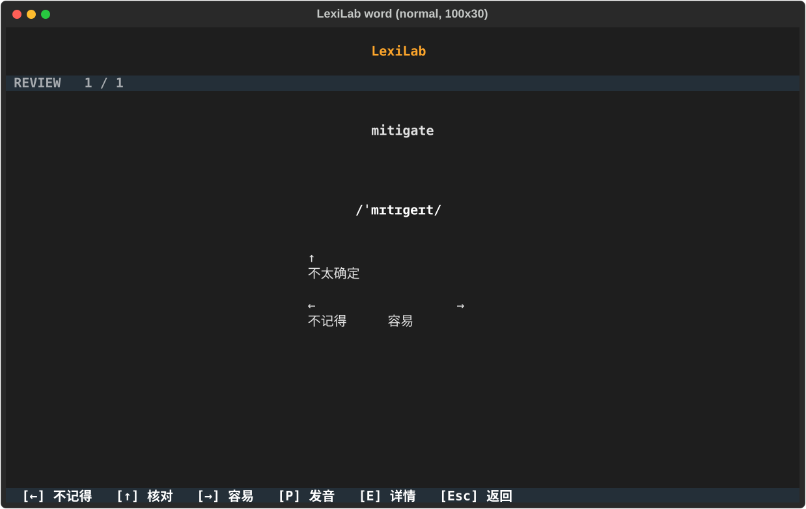
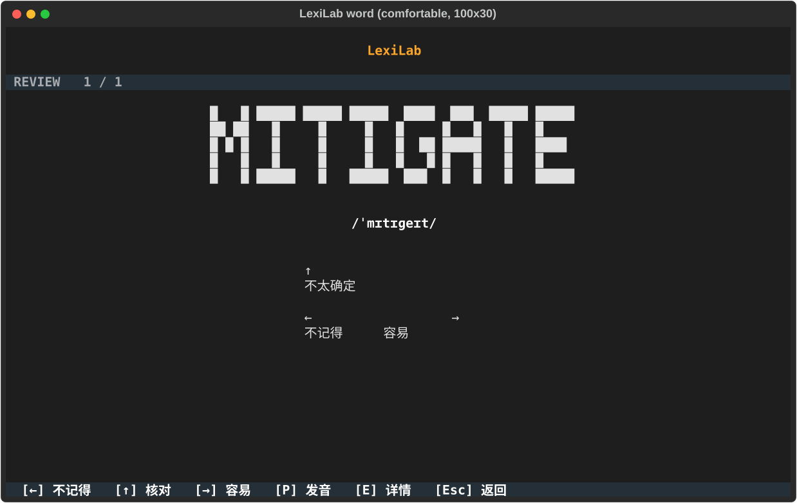
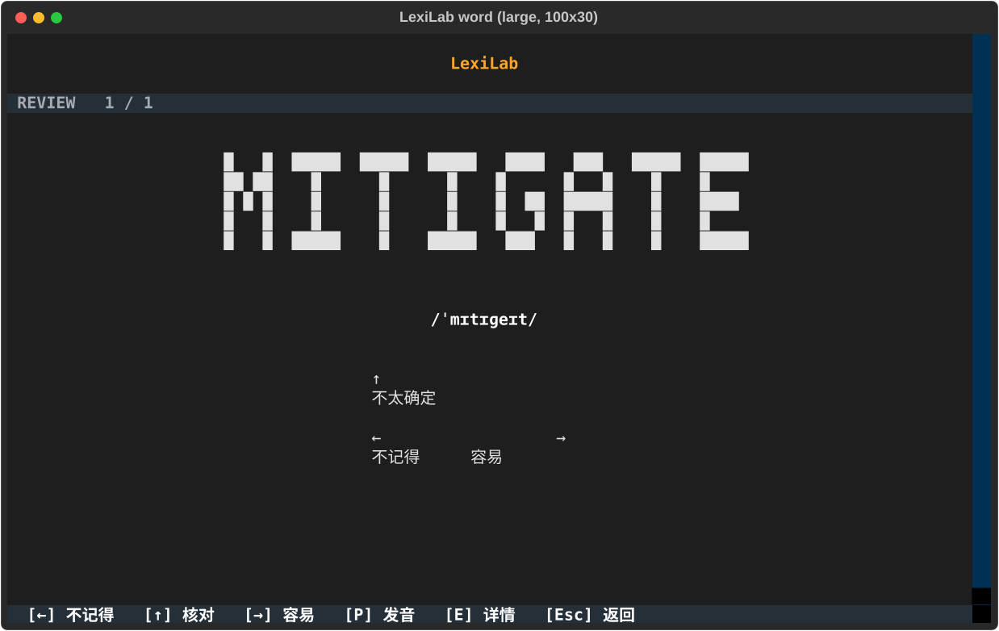

# LexiLab 显示与字体指南

## 1. 终端字体

LexiLab 运行在终端字符网格中，不能通过程序直接修改终端的真实字体大小。建议把终端字体设置为 **18–22 pt**，再根据窗口大小选择 LexiLab 显示模式。

### Windows Terminal

Settings → Profiles → Defaults → Appearance → Font size。

### VS Code 集成终端

在 `settings.json` 中设置：

```json
{
  "terminal.integrated.fontSize": 20
}
```

### MobaXterm

Settings → Configuration → Terminal → Font。

### Linux 终端

GNOME Terminal / Konsole 等使用各自 Profile 的字体设置。LexiLab 不会修改这些全局配置。

## 2. LexiLab 显示模式

配置位于 `configs/settings.toml`：

```toml
[ui]
display_mode = "comfortable"  # normal / comfortable / large
large_word_display = true
high_contrast = true
compact_mode = false
```

| 模式 | 行为 |
|---|---|
| `normal` | 普通粗体单词，适合最小窗口/快速浏览 |
| `comfortable` | 默认；空间足够时使用 5 行块状字模，释义和提示使用高对比度文本 |
| `large` | 更宽的字模间距和额外垂直留白；空间不足时自动回退 |

块状字模只覆盖英文单词常见字符；长词、带不支持字符的词、窄窗口会自动回退普通文本，不会截断单词。

## 3. 自适应规则

- 宽窗口、足够高度：显示大字符单词、音标、释义、例句和方向键提示。
- 窄窗口（约 < 64 列）或矮窗口（约 < 20 行）：自动使用普通粗体单词；粒子区域隐藏，方向键提示压缩为单行，底部快捷键精简，保留输入和评分。
- 运行时缩放终端会立即重排，不改变当前卡片、输入内容或评分状态。
- 中文释义、音标、输入框始终是普通文本，不依赖块状字模。

## 4. 截图

`docs/screenshots/` 包含 Textual 实际渲染导出的 SVG：

- `main_menu.svg`：极简主菜单
- `word_before_normal.svg`：普通模式（修改前对照）
- `word_after_comfortable.svg`：默认舒适模式（修改后）
- `word_after_large.svg`：大字符模式
- `word_small_terminal.svg`：44×16 小窗口自动回退

普通模式：



舒适模式（默认）：



大字符模式：



SVG 可以直接在浏览器中查看；终端字体本身仍需按上表在终端程序中设置。
